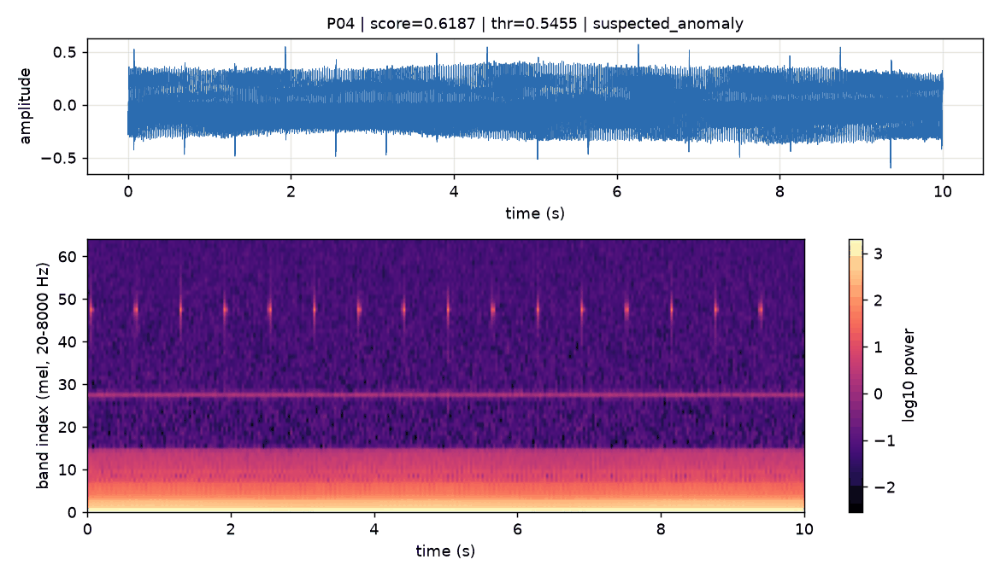
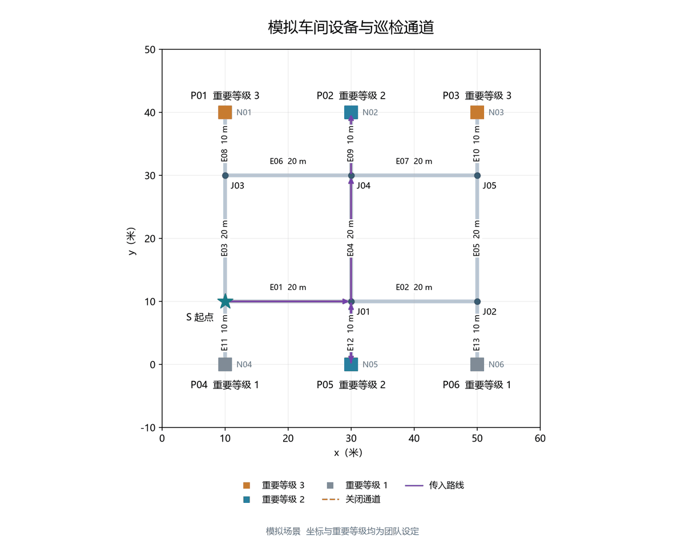

# 海工智维 · 设备运维助手

上传设备运行录音，判断设备是否异常，按异常结果排出巡检路线，并逐点执行确认。

单页 Streamlit 应用，一个 Agent 调用三个工具完成调度。检测分数、路线和距离都由底层算法模块产出，决策模型只决定「先调哪个工具、传什么参数」，不参与产生任何数值。

**在线演示**：<https://781e53a3ab614045b58e94dd2692df36.app.workbuddy.link>
**工程详版**（接口契约 / 部署 / 验收记录）：[`docs/PROJECT_NOTES.md`](docs/PROJECT_NOTES.md)

<p align="center">
  
  
</p>
<p align="center">
  <sub>左：P04 录音的波形与梅尔频谱，score 0.6187 / 阈值 0.5455 / suspected_anomaly。
  右：从起点 S 到目标设备的巡检路线，紫色为规划结果，红色虚线为封闭通道。</sub>
</p>

---

## 目录

- [它解决什么问题](#它解决什么问题)
- [快速开始](#快速开始)
- [界面五个区域](#界面五个区域)
- [三种决策模式](#三种决策模式)
- [演示流程](#演示流程)
- [接入真实大模型（可选）](#接入真实大模型可选)
- [输入要求](#输入要求)
- [数据来源与边界](#数据来源与边界)
- [目录结构](#目录结构)
- [文档索引](#文档索引)
- [已知限制](#已知限制)

## 它解决什么问题

工业现场的巡检通常靠人按固定路线走，异常设备发现得晚、路线也是最远的。这个应用把两件事串起来：

1. **只听声音判断异常**——设备正常运行时噪声稳定，出现轴承磨损、松动、气蚀时频谱会变。模型给出相对异常分数，与阈值比较后落到「正常 / 疑似异常 / 输入无效」三态。
2. **按异常结果排路线**——不是把所有设备都走一遍，而是把有限的巡检时间优先给疑似异常、且重要等级高的设备，同时支持临时封路后重新规划。
3. **走的过程中随时改**——巡检执行环节记录当前位置、已完成、待检、已走距离；封路后从当前位置重排，已经走过的路和已确认的设备不会被重置。

页面顶部的实测链路：

| 环节 | 输入 | 输出 |
| --- | --- | --- |
| 音频检测 | 16 kHz 单声道 WAV + 设备编号 | 异常分数、阈值、状态、频谱图、质量标记 |
| 巡检规划 | 检测结果 + 起点 + 封闭通道 | 优先级、访问顺序、总距离、不可达设备 |
| 巡检执行 | 上一步的规划 + 当前节点 | 已走距离、剩余路线、待检清单、任务状态 |
| 报告 | 以上全部 | Markdown 报告，可下载 |

## 快速开始

仓库不含虚拟环境（约 500 MB，已被 `.gitignore` 排除），克隆后先建环境。

```bash
git clone https://github.com/xiao-o-o/haigong-om-app.git
cd haigong-om-app
python -m venv .venv
```

Windows：

```bash
.venv\Scripts\pip install -r requirements.txt
.venv\Scripts\streamlit run app.py
```

macOS / Linux 把 `.venv\Scripts` 换成 `.venv/bin`。浏览器打开 <http://localhost:8501>。

要求 Python **3.11+**，全部实测结论出自 3.13.14。

**不需要任何密钥**也能完整运行：未配置大模型时自动使用规则版决策器，检测和规划功能不受影响。

模型文件 `models/pump_v1.joblib` 是 sklearn 序列化对象，必须与训练时的 sklearn 版本同代（`requirements.txt` 已锁 `scikit-learn>=1.9,<2`）。版本不符会在真实模式下报反序列化错误，重新导出模型即可，不是代码问题。

## 界面五个区域

| 区域 | 做什么 | 关键操作 |
| --- | --- | --- |
| ① 总览 | 模块状态、数据流、预算与里程碑 | 只读，用来确认 A / C / D 三个模块都加载成功 |
| ② 设备音频批量检测 | 上传 WAV 并指定设备编号，逐台推理 | 选「内置演示录音」或「全场景模拟」，或自己上传 |
| ③ 巡检规划 | 按检测结果排路线；下方另有「巡检执行（模拟）」和「规划案例对照」 | 设置起点、封闭通道；执行区可用「前进一步 / 确认到达 / 封路重规划」 |
| ④ 本地检查资料 | 按关键词检索检查条目与来源链接 | 输入关键词，如「疑似异常 复核」 |
| ⑤ Agent 助手 | 一句话完成多步：检测 → 规划 → 检索 | 输入自然语言，看右侧轨迹里的工具序列与耗时 |

侧边栏可切换「运行模式」（模拟数据 / 真实模型）与「决策器」（自动 / 仅 LLM / 仅规则版），并显示当前预算用量（6 轮 / 12 次为硬上限）。

## 三种决策模式

| 模式 | 行为 | 适用场景 |
| --- | --- | --- |
| 自动（默认） | 大模型优先，超时、报错或计划不合法时回退规则版 | 日常使用 |
| 仅 LLM | 失败直接报错，不静默回退 | 演示时可证明模型确实在工作 |
| 仅规则版 | 完全离线，不调用外部接口 | 无网络、无密钥 |

三层防护保证结果不被模型污染：工具名白名单；设备编号只能取自本次送检的文件；通道与节点只能取自场景表；步数上限 6 步，且必须先检测后规划。任一条不过即回退，轨迹里写明拒绝原因。

## 演示流程

以下四种状态都在本机实测过。

| 场景 | 操作 | 预期结果 |
| --- | --- | --- |
| 单目标 | 「内置演示录音」→ 检测 → 规划 | `status=ok`，唯一目标 P04，`total_distance_m=10.0` |
| 全场景 | 切「全场景模拟（P01–P06）」→ 检测 → 规划 | `status=ok`，优先级 P03→P04→P06，访问顺序 P03→P06→P04，`170.0 m` |
| 部分达成 | 检测 P01 + P04 → 规划时关闭 E11 | `status=partial`，`visit_order=[]`，不可达 `['P04']` |
| 无需巡检 | 只放 P01（正常） | `status=no_targets`，明确说明没有目标，不凑一条空路线 |

内置录音的实测分数：

| 设备 | 分数 | 阈值 | 状态 |
| --- | --- | --- | --- |
| P01 | 0.4557 | 0.5455 | `normal` |
| P04 | 0.6187 | 0.5455 | `suspected_anomaly` |

分数是相对异常程度，不是故障概率，也不判断具体损坏部件。

**走一遍巡检执行**（模拟数据即可，不消耗模型）：

1. 「③ 巡检规划」→「巡检执行（模拟）」→ 从 C1 案例或录音检测结果创建任务，起点 S，待检 P02 / P05，剩余 70 m；
2. 连点两次「前进一步」→ 到达 N05，已走 30 m，剩余 40 m；
3. 未确认就继续前进会被拒绝（`MissionError`），位置与里程不变；
4. 点「确认到达」→ 待检只剩 P02；
5. 关闭 E04 → 剩余 80 m，累计 110 m，当前位置不被重置；
6. 重新开放 E04 → 剩余 40 m，累计 70 m；
7. 关闭 E09 → 状态 `blocked`，P02 不可达，剩余里程显示「不可用」，**不显示已完成**；
8. 恢复 E09 后走 N05 → J01 → J04 → N02，确认 P02 → 状态 `completed`。

完整步骤见 [`docs/CD_DEMO_C1.md`](docs/CD_DEMO_C1.md)。

## 接入真实大模型（可选）

默认走规则版，不配也能用。要接真实模型，编辑 `.streamlit/secrets.toml`（从 `secrets.toml.example` 复制）：

```toml
LLM_BASE_URL = "https://api.deepseek.com/v1"   # 到 /v1 为止，不要带 /chat/completions
LLM_MODEL    = "deepseek-flash"                # 正式名；deepseek-chat 已停用
LLM_THINKING = "auto"                          # 自动关闭思考模式，避免变慢与多计费
LLM_API_KEY  = "sk-..."
```

三项（`LLM_BASE_URL` / `LLM_API_KEY` / `LLM_MODEL`）缺任意一项即视为未配置，自动走规则版。

**不要写 `LLM_API_KEY = ""` 这种空占位**：Streamlit 会把空串同步进环境变量，把外面真实的密钥冲成空值，表现为「明明配了却显示未配置」。用不到的行直接注释掉。

配好后先跑自检，四步全通过再开页面：

```bash
.venv\Scripts\python.exe check_llm.py
```

自检依次检查：配置读取 → 连通性（真实发一次请求）→ 规划能力（三个真实任务）→ 越权拦截（故意让它引用不存在的编号 P99）。任一步失败都给出排查方向，退出码非 0。

```
[通过] 响应正常，耗时 0.9s
[通过] 模型没有编造设备编号，直接给出合法计划
结论：链路通、模型能产出合法计划、越权被拦住。可以正常演示了。
```

更换密钥或模型名后需重启页面（热重载不会重读密钥）。

## 输入要求

- 只接受 **16 kHz 单声道 WAV**，时长 ≥ 1 秒；
- 每个文件必须手动指定设备编号 P01–P06，不从文件名推断；
- 采样率不符、空文件、全零、过短 → 返回 `invalid_input`，页面如实显示，不计入「正常」；
- 请求了但没有音频文件的设备单独列为 `missing_asset_ids`，不产生分数，不等同于正常。

当前版本不做重采样。

## 数据来源与边界

| 内容 | 口径 | 性质 |
| --- | --- | --- |
| `models/pump_v1.joblib` | 团队此前的演示包 | **合成演示** |
| `samples/*.wav` | 演示录音，每段 10 s / 16 kHz / 16 bit | **合成演示** |
| `scene/*.csv` | 团队自拟的节点、通道、设备与距离 | **模拟厂区** |
| `knowledge/checklist.json` 中 K-001、K-002 | MIMII、DCASE 2020 Task 2 官方说明 | 公开资料 |
| `knowledge/checklist.json` 中 K-003 至 K-005 | 团队设定 | **自拟规则** |

**边界声明**

1. 检测分数是相对异常程度，**不是故障概率**，也不判断具体损坏部件；
2. `scene/` 是模拟厂区，路线与距离仅用于演示调度逻辑，不构成实际作业指导；
3. 当前模型与录音按合成演示口径，**不能据此声称已完成 MIMII 真实数据训练，也不能用于评价检测准确率**；
4. 本仓库为课程团队共同成果，仅用于课程展示。

MIMII Dataset（Hitachi, Ltd.，CC BY-SA 4.0，<https://zenodo.org/record/3384387>）是后续计划采用的公开数据集参考。

> H. Purohit, R. Tanabe, K. Ichige, T. Endo, Y. Nikaido, K. Suefusa, and Y. Kawaguchi,
> "MIMII Dataset: Sound Dataset for Malfunctioning Industrial Machine Investigation and Inspection,"
> in *Proc. 4th Workshop on Detection and Classification of Acoustic Scenes and Events (DCASE)*, 2019.

## 目录结构

```
app.py                   单页主入口（五个区域）
agent/
  loop.py                单 Agent 主循环：6 轮 / 12 次预算、轨迹计时、日志出口
  planner.py             决策器：大模型规划 + 白名单校验 + 规则版回退
  tools.py               三个工具：检测 / 规划 / 知识库
core/
  local_modules.py       三个底层模块的唯一 import 入口 + 场景表读取 + 健康检查
  llm.py                 OpenAI 兼容客户端（只给决策器用）
  report.py              Markdown 报告生成
  runlog.py              运行日志：run_id、脱敏、参数摘要
audio_module/ models/ samples/     音频检测（模型 + 录音）
spatial_module/ scene/             巡检规划与绘图（含 mission.py 任务执行）
knowledge/checklist.json           检查条目
examples/cd_cases.json             三个手工设定的规划案例
check_cd.py / check_cd_mission.py  规划与任务执行检查（各 23 项）
check_llm.py                       大模型接入自检（四步）
docs/                              文档与配图
```

## 文档索引

| 文档 | 内容 |
| --- | --- |
| [`docs/PROJECT_NOTES.md`](docs/PROJECT_NOTES.md) | 工程详版：接口契约、决策器三层设计、日志格式、环境变量、部署、交付清单、风险与红线 |
| [`docs/acceptance.md`](docs/acceptance.md) | 功能验收记录与未测项清单 |
| [`docs/prompts_and_outputs.md`](docs/prompts_and_outputs.md) | 三组提示词、执行轨迹、Agent 原文回答与 run_id |
| [`docs/CD_TASK.md`](docs/CD_TASK.md) | 巡检执行的任务范围与验收口径 |
| [`docs/CD_WORKLOG.md`](docs/CD_WORKLOG.md) | 规划与执行的修改记录 |
| [`docs/CD_DEMO_C1.md`](docs/CD_DEMO_C1.md) | C1 案例的页面演示步骤 |
| [`docs/publish-github.md`](docs/publish-github.md) | 发布到 GitHub 的步骤与常见报错 |

## 已知限制

1. 本机实测为 Python 3.13.14；团队若统一到 3.12，需先在目标版本上验证模型能反序列化；
2. 模型与录音是合成演示口径，更换机型或换真实数据须重新评估并记录；
3. 巡检执行为逻辑模拟，不接入实时定位，距离来自场景表而非实际走行；
4. 当前版本不做音频重采样，采样率不符直接判为 `invalid_input`。

---

本仓库未附开源许可，默认保留所有权利。用于课程展示之外的目的前请先联系团队成员。
